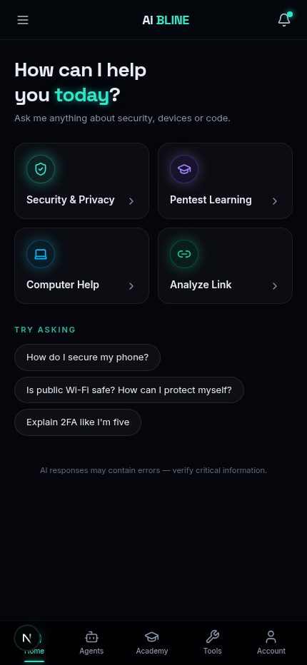
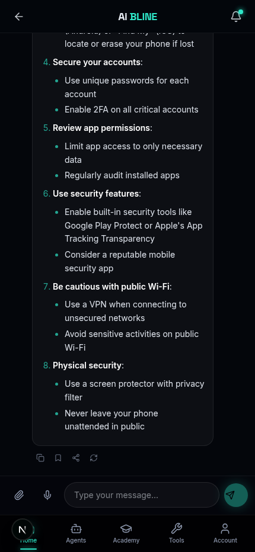
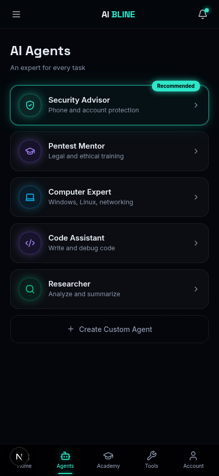
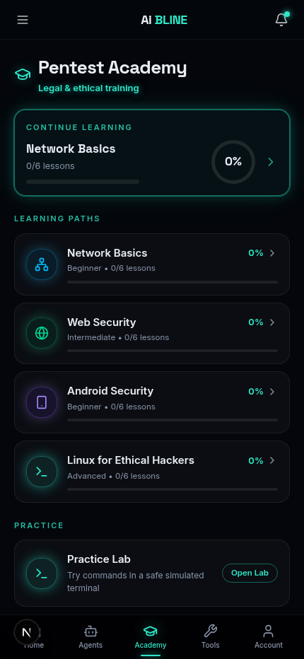
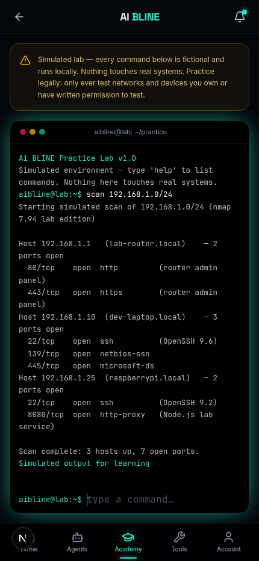
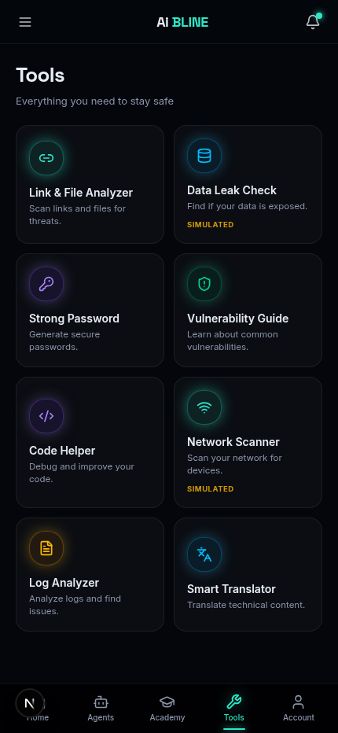
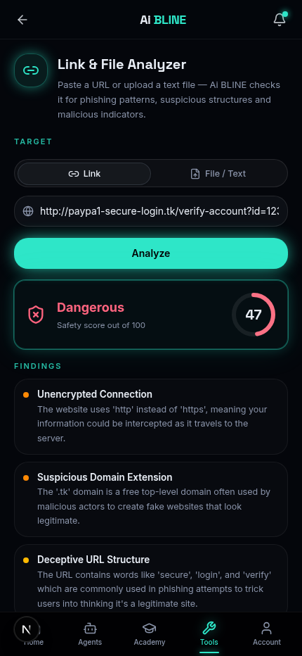
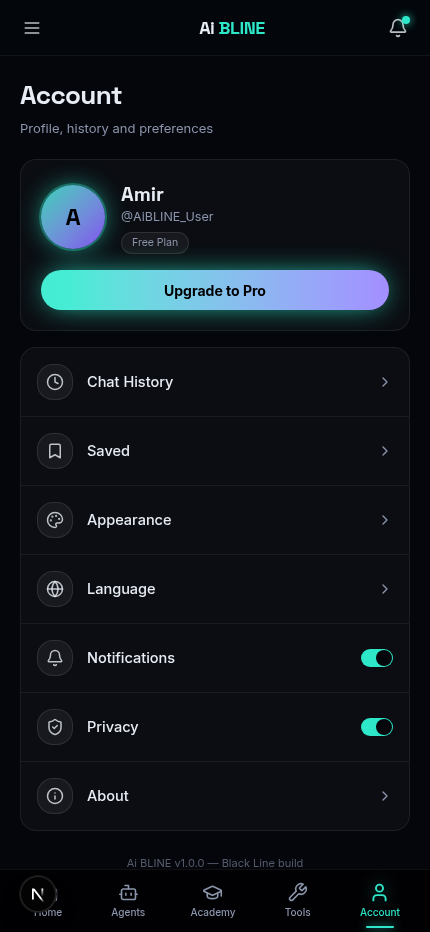

<div align="center">


# ⚡ Ai BLINE

**Your AI copilot for security, learning & everyday computer work — wrapped in a black-line neon mobile experience.**

[](https://nextjs.org)
[](https://www.typescriptlang.org)
[](https://tailwindcss.com)
[](LICENSE)

[Features](#-features) · [Screenshots](#-screenshots) · [Quickstart](#-quickstart) · [Android APK](#-android-apk) · [Structure](#-project-structure) · [Roadmap](#-roadmap)

</div>

---

## 🤔 What is Ai BLINE?

Ai BLINE is a **full-featured, open-source AI assistant** for cybersecurity learning, device
protection and programming help. It combines a real AI chat, five specialist agents, a legal &
ethical penetration-testing academy, and a complete security toolbox — all in a stunning
**"Black Line" neon theme** designed mobile-first, with a desktop phone-frame preview.

Everything is real and functional: chats persist in SQLite, academy progress is tracked,
tools call AI + deterministic heuristics, and the whole experience works on web and
as an installable Android app.

> 🔒 **Ethics first** — every security feature is strictly legal, defensive and educational.
> The app teaches *how to protect*, never *how to attack*.

---

## ✨ Features

### 💬 Home — AI Chat
- Real AI conversations about phone/computer security, privacy and code
- Beautiful markdown rendering with code blocks & copy buttons
- Quick actions, recent chats, file/text attachment analysis
- Save, copy, share & regenerate any answer

### 🤖 AI Agents
Five specialists, one tap away:

| Agent | Specialty |
| --- | --- |
| 🛡️ **Security Advisor** | Phone hardening, account protection, phishing defense |
| 🎓 **Pentest Mentor** | Legal & ethical pentesting methodology for authorized labs |
| 💻 **Computer Expert** | Windows / Linux / macOS, networking, performance |
| ⌨️ **Code Assistant** | Write, debug & review code in any language |
| 🔍 **Researcher** | Structured deep-dives and comparisons |

Plus **Create Custom Agent** — design your own specialist with icon & accent color.

### 🎓 Pentest Academy
- 4 learning paths × 6 lessons: Network Basics, Web Security, Android Security,
  Linux for Ethical Hackers
- 24 lessons with key points and knowledge-check quizzes
- Real progress tracking with animated neon progress rings
- **Practice Lab** — a safe simulated terminal (`scan`, `hash` with real SHA-256, and more)

### 🛠️ Security Toolbox
| Tool | What it does |
| --- | --- |
| 🔗 Link & File Analyzer | Phishing heuristics + AI verdict with safety score |
| 🗄️ Data Leak Check | Simulated breach lookup + response playbook |
| 🔑 Strong Password | Crypto-secure generator with entropy meter |
| 🛡️ Vulnerability Guide | Learn how vulnerabilities work & how to prevent them |
| ⌨️ Code Helper | AI code review with improved code output |
| 📶 Network Scanner | Simulated lab scan — learn how discovery works |
| 📄 Log Analyzer | Error counts, root causes and suggested fixes |
| 🌐 Smart Translator | Technical translations preserving security terms |

### 👤 Account
Chat history, saved snippets, **4 accent themes + AMOLED mode**, language,
notifications, privacy controls with local-only history, and demo plans.

---

## 📸 Screenshots

<div align="center">
<table>
  <tr>
    <td></td>
    <td></td>
    <td></td>
    <td></td>
  </tr>
  <tr>
    <td align="center">Home</td>
    <td align="center">AI Chat</td>
    <td align="center">Agents</td>
    <td align="center">Academy</td>
  </tr>
  <tr>
    <td></td>
    <td></td>
    <td></td>
    <td></td>
  </tr>
  <tr>
    <td align="center">Practice Lab</td>
    <td align="center">Tools</td>
    <td align="center">Link Analyzer</td>
    <td align="center">Account</td>
  </tr>
</table>
</div>

---

## 🚀 Quickstart

```bash
# 1. Clone
git clone https://github.com/your-username/ai-bline.git
cd ai-bline

# 2. Install dependencies
bun install        # or: npm install

# 3. Environment
echo 'DATABASE_URL="file:../db/custom.db"' > .env

# 4. Create the database
bun run db:push    # or: npx prisma db push

# 5. Run
bun run dev        # or: npm run dev
```

Open **http://localhost:3000** — the UI is mobile-first; on desktop it renders inside a
phone frame with a marketing panel.

### Environment variables

| Variable | Required | Description |
| --- | --- | --- |
| `DATABASE_URL` | ✅ | SQLite file URL, e.g. `file:../db/custom.db` |
| `AIBLINE_SERVER_URL` | — | Deployed app URL used by the Android shell (`capacitor.config.ts`) |

---

## 📱 Android APK

Ai BLINE ships with everything needed to produce a real, installable APK:

- `capacitor.config.ts` — ready-made Capacitor configuration (icon, splash, theme)
- `docs/BUILD_APK.md` — **step-by-step guide** (deploy → wrap → `gradlew assembleDebug`)

```bash
npm install @capacitor/core @capacitor/cli @capacitor/android
export AIBLINE_SERVER_URL="https://your-deployed-app.vercel.app"
npx cap add android && npx cap sync android
cd android && ./gradlew assembleDebug
# → android/app/build/outputs/apk/debug/app-debug.apk ✅
```

No Android Studio right now? The app is also a **full PWA** — open it in Chrome and
*Add to Home screen* for an app-like experience instantly.

---

## 🧱 Project Structure

```
ai-bline/
├── prisma/
│   └── schema.prisma          # ChatSession, Message, SavedItem, LessonProgress
├── public/
│   ├── manifest.json          # PWA manifest
│   ├── icon-1024.png          # App icon (PWA + Android)
│   └── banner.png
├── src/
│   ├── app/
│   │   ├── layout.tsx         # Fonts, metadata, theme bootstrap
│   │   ├── page.tsx           # Single-route app shell
│   │   └── api/
│   │       ├── chat/          # AI chat (agents + custom agents)
│   │       ├── history/       # Sessions & messages CRUD
│   │       ├── saved/         # Saved items API
│   │       ├── academy/       # Progress tracking API
│   │       └── tools/         # 7 AI tool endpoints
│   ├── components/
│   │   ├── app/               # Shell: phone frame, header, nav, logo
│   │   ├── screens/           # 5 tab screens
│   │   ├── chat/              # Chat view, markdown, bubbles
│   │   ├── tools/             # 8 tool implementations
│   │   ├── academy/           # Path, lesson, quiz, lab terminal
│   │   ├── account/           # Profile & settings views
│   │   └── ui/                # shadcn/ui primitives
│   └── lib/
│       ├── store.ts           # Zustand navigation + settings
│       ├── agents.ts          # Agent definitions & prompts
│       ├── academy-data.ts    # Full curriculum (24 lessons)
│       ├── colors.ts          # Theme maps & tool definitions
│       ├── llm.ts             # Backend AI SDK helpers
│       └── db.ts              # Prisma client
├── capacitor.config.ts        # Android shell config
└── docs/BUILD_APK.md          # APK build guide
```

---

## 🛣️ Roadmap

- [ ] Voice input & speech-to-text chat
- [ ] Streaming AI responses
- [ ] Multi-language UI (Persian, Arabic, Turkish)
- [ ] Real Have-I-Been-Pwned integration (opt-in API key)
- [ ] Certificate export for completed academy paths
- [ ] Team plan with shared lab environments

---

## 🤝 Contributing

Contributions are welcome! Please open an issue first to discuss what you'd like to change.
All security content must remain strictly legal, ethical and defensive.

## ⚖️ Ethics & Legal

Ai BLINE is an **educational sample project**. All security guidance is defensive and intended
for authorized, legal use only. The Data Leak Check and Network Scanner are clearly-labeled
simulations — they never contact real systems.

## 📄 License

[MIT](LICENSE) © 2025 Ai BLINE

<div align="center">

**Made with ⚡ by the Ai BLINE project**

</div>
